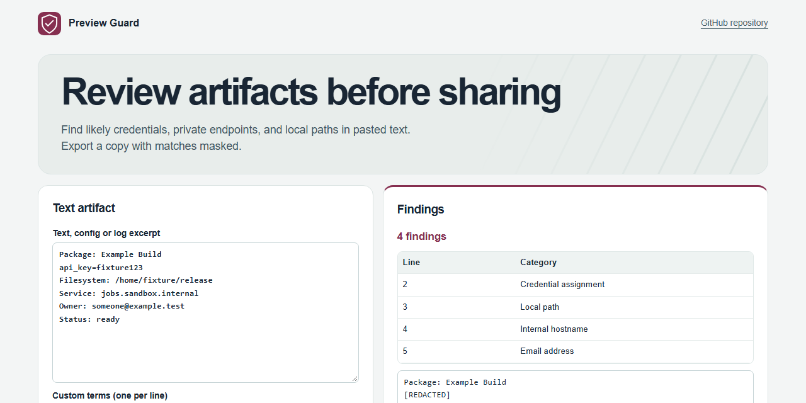

# Preview Guard

**Review artifacts before sharing.** Find likely credentials, private endpoints, and local paths in pasted text. Export a copy with matches masked.

[Open the live tool](https://musabukhari237.github.io/preview-guard/) · [Report an issue](https://github.com/MusaBukhari237/preview-guard/issues)

[](https://musabukhari237.github.io/preview-guard/)

## Try it

Choose **Load redaction example**, then **Scan artifact**. Findings list a line number and category. Use custom terms for project names or identifiers you want to remove.

## How it works

Looks for familiar credentials, login URLs, local paths, private network addresses and configured terms. The report replaces matching spans while preserving line breaks. Review a redacted copy before sharing it.

## Run locally

Clone the repo and serve the `docs` folder from localhost.

```sh
python -m http.server 8000 --bind 127.0.0.1 --directory docs
```

Open http://127.0.0.1:8000 in a current browser. Run `node --test` from the repository root with Node.js 22 or later.

## Sponsors

Supported by [LeadCeleris](https://www.leadceleris.com/) and [AIFFICIENTO](https://www.aifficiento.biz/).

## Contributing

Read [CONTRIBUTING.md](CONTRIBUTING.md) and use synthetic fixtures in issue reports. The source is available under the [MIT license](LICENSE).
